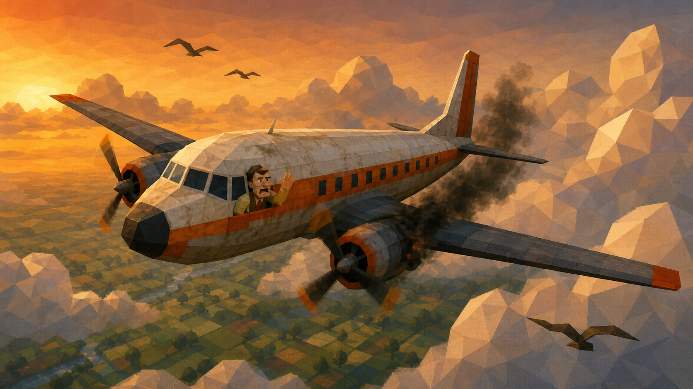

# Dear Passengers

> ⚠️ **18+ | Создана в развлекательных целях. Не повторяйте в реальной жизни. Все совпадения случайны.**

Неофициальное фан-переиздание кооперативной игры **«Dear Passengers»** (Steam, FLEXUS) — экипаж
«худшей авиакомпании мира»: один пилот, остальные — бортпроводники, 12 пассажиров, физический хаос,
турбулентность, птицы в двигателях и заправка прямо в воздухе.



## Что реализовано (v1.0)

- **Кооператив до 8 игроков** — лобби по 6-символьному коду (или IP:порт), старт рейса владельцем,
  все спавнятся сразу в самолёте/зале ожидания. Netcode for GameObjects.
- **Голосовой чат** — push-to-talk **V** (или активация голосом): микрофон → μ-law 8 кГц → RPC.
- **Пилотирование** — сесть за штурвал (**E**), мышь — крен/тангаж, W/S — тяга, A/D — курс,
  T — автопилот, R — встать. Сваливание, турбулентность (Perlin), воздушные ямы, посадка.
- **Пассажиры** — стейт-машина: спокойствие → паника → агрессия → успокоение. Стресс от
  турбулентности, пожара, открытой двери; паника заразна; драки; успокаивать словом (**E**) или
  водой (**F** из буфета); тащить на себе (удержание **E**) и выбрасывать за борт (**ЛКМ** у
  открытой двери). 18+.
- **Птицы и столкновения** — стаи по курсу, попадание в двигатель = пожар, в лобовое = трещины.
- **Заправка в полёте (мини-игра)** — при топливе < 25% прилетает заправщик: выход на крыло через
  люк (ветер сносит!), взять шланг, удерживать маркер в кольце (WASD).
- **Ценный груз** — вазы (бьются в турбулентности), контрабанда (нервирует пассажиров), живая
  черепаха в багаже. Влияет на оплату в конце рейса.
- **Меню и настройки** — 18+ гейт, громкость, чувствительность, инверсия Y, качество, полный экран,
  режим голоса. Всё сохраняется.
- **Звук** — полностью процедурный синтез (двигатели, ветер, паника, удары, радиообъявления с
  субтитрами и чёрным юмором).

Весь контент (модели, текстуры, звуки, UI) генерируется кодом при запуске — проект весит меньше
мегабайта и собирается с нуля.

## Управление

| Клавиша | Действие |
|---|---|
| WASD / Shift / Space / C | ходьба / бег / прыжок / присед |
| Мышь | обзор (в пилотском кресле — штурвал) |
| E | взаимодействие (дверь, штурвал, вода, пассажир); удерживать — схватить пассажира |
| F | вторичное действие (напоить пассажира / подключить шланг) |
| ЛКМ | удар (или выброс пассажира у открытой двери) |
| V | голосовой чат (push-to-talk) |
| Y | (хост, на стоянке) начать взлёт |
| Esc | пауза / настройки |

## Сборка

### Локально (одна команда)

Нужен [Unity 2022.3.62f1](https://unity.com/releases/editor/whats-new/2022.3.62) (hub: `unityhub://2022.3.62f1/4af31df58517`). Затем из корня репозитория:

**Windows (PowerShell/CMD):**
```
"C:\Program Files\Unity\Hub\Editor\2022.3.62f1\Editor\Unity.exe" -batchmode -quit -projectPath . -executeMethod DearPassengers.EditorTools.BuildScript.BuildWindows
```
Готовый билд: `builds/DearPassengers/DearPassengers.exe`.

Через редактор: меню **Dear Passengers → Build Windows x64** (первое открытие проекта запустит
мастер настройки — префабы, URP, сцены — автоматически).

### GitHub Actions (CI)

`.github/workflows/build.yml`: ubuntu-latest + [game-ci/unity-builder@v4](https://game.ci) +
кэш Unity Library + артефакт на каждый пуш + автоматический **Release** на тег `v*`.

Для активации Unity Personal в CI добавьте в секреты репозитория:
- `UNITY_LICENSE` — содержимое `.ulf`-файла лицензии (Game CI → «Personal license»);
- `UNITY_EMAIL` и `UNITY_PASSWORD` — e-mail/пароль Unity-аккаунта.

Без них workflow упадёт на шаге активации лицензии — это ограничение Unity, а не проекта.

## Структура проекта

```
Assets/Scripts/Core       — настройки, bootstrap сцен, процедурные ассеты, мир
Assets/Scripts/Player     — контроллер игрока от первого лица
Assets/Scripts/Plane      — самолёт, полётная модель, двери, штурвал
Assets/Scripts/NPC        — пассажиры (стейт-машина), птицы
Assets/Scripts/Networking — Netcode: сессия рейса, лобби-коды, спавн игроков
Assets/Scripts/UI         — меню, лобби, HUD, настройки
Assets/Scripts/Audio      — синтез звуков, радио, голосовой чат
Assets/Scripts/Minigames  — заправка в воздухе
Assets/Scenes             — MainMenu, Lobby, Airplane, Flight
Assets/Editor             — мастер настройки проекта и BuildScript
docs/                     — исследование оригинала и ГДД
```

Документация: [docs/RESEARCH.md](docs/RESEARCH.md) · [docs/GDD.md](docs/GDD.md).

## Бесплатные ассеты (по желанию)

Игра полностью самодостаточна (всё генерируется кодом), но при желании можно подменить
процедурные модели на эти бесплатные пакеты Asset Store — просто импортируйте в `Assets/`:

1. [Simple Aircraft Pack](https://assetstore.unity.com/packages/3d/vehicles/air/simple-aircraft-pack-288110) — низкополигональные самолёты.
2. [Free Pack Lowpoly People](https://assetstore.unity.com/packages/3d/props/free-pack-lowpoly-people-325566) — низкополигональные люди (пассажиры).
3. [City-Themed Low Poly Characters Free Pack](https://assetstore.unity.com/packages/3d/characters/city-themed-low-poly-characters-free-pack-324242) — персонажи для экипажа.
4. [FREE Low Poly Human RPG Character](https://assetstore.unity.com/packages/3d/characters/humanoids/fantasy/free-low-poly-human-rpg-character-219979) — модель от первого/третьего лица.
5. [Free Sound Effects Pack Starter](https://assetstore.unity.com/packages/audio/sound-fx/free-sound-effects-pack-starter-all-categories-155776) — 51 WAV звук (авиа-звуки в проекте синтезируются).

## Требования

- Unity **2022.3.62f1** (LTS) + пакеты: Netcode for GameObjects 1.15.0, Input System 1.7.0,
  Cinemachine 2.9.7, URP 14.0.8, TextMeshPro 3.0.6 (см. `Packages/manifest.json`).
- Windows 10/11 x64 для готового билда.

---

⚠️ **18+ | Создана в развлекательных целях. Не повторяйте в реальной жизни. Все совпадения случайны.**
Фанатский проект, не связан с FLEXUS и Steam. Не для коммерческого использования.
